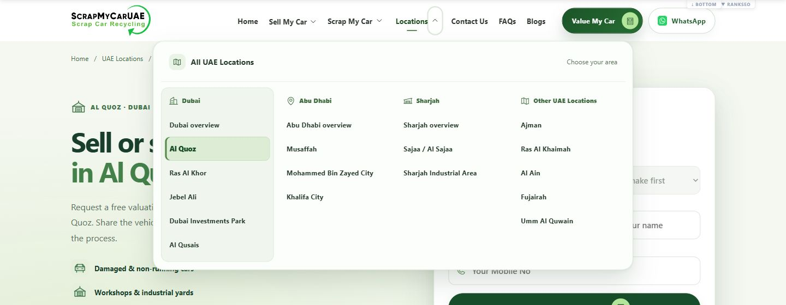

# Published Locations navigation QA

20 October 2026 · development / staging only.

- All 19 published routes are generated from `src/lib/location-navigation.ts` for both navigation surfaces. Rendered HTML was checked on every route: 19 unique destination links per surface, exactly one current-page marker, and one matching active group (none on the UAE hub).
- All 19 destinations return direct HTTP 200. Representative real menu navigation passed for Dubai overview, Musaffah, MBZ City, Sajaa, Sharjah Industrial Area, Ajman, Umm Al Quwain and the UAE hub.
- Mobile: 390, 430, 768, 1024 and 1100px. All four groups open correctly, expose their complete lists and use 56px touch targets. Back restores the originating group button; Back to main restores Locations. Close/Escape returns focus to the opener, unlocks body scroll and leaves no inactive view in the tab order.
- Desktop: 1280 and 1440px. Four-column menu contains 19 unique links and fits within the viewport. Exact page and matching group highlighting verified. The main Locations label remains a direct hub link. No hover dismissal/gap was introduced; it retains the existing native disclosure interaction.
- Short-height checks: desktop 1280×400 and phone 390×568. Internal scrolling exposes the last links without horizontal overflow. Desktop Escape works from a link and restores summary focus. Phone Shift+Tab from Close wraps to the last action; Tab wraps back to Close.
- Hub/parent/child URLs, page content, metadata, QuoteForm, Wix, analytics and WhatsApp logic were not modified. Sell (8 links), Scrap (5 links) and their existing desktop exclusivity / mobile Back behavior passed regression checks. Header CTA URLs are unchanged.
- Opaque mega-menu background prevents text showing through. Existing reduced-motion rules disable menu animation/transitions; preference guards were reviewed in source, not OS-emulated.
- Final checks: **153 tests passed, 0 failed**, staging Astro build passed. No dependencies added. Final deployment is through the existing development GitHub Actions workflow.

