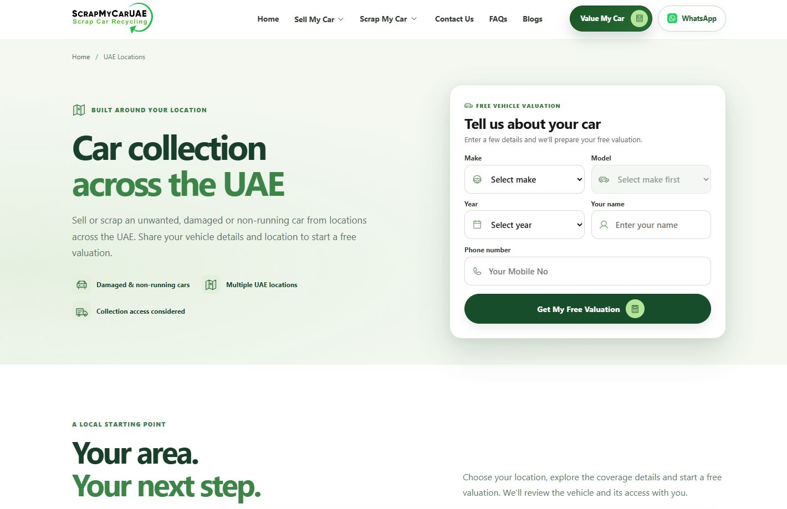

# Locations redesign verification

Application revision: `34b66053879800784a0e273b10b5434cde93a9b3`.

- Local tests: 99 passed. Staging build passed.
- Staging workflow: [39066896586](https://github.com/auralinkone-hue/scrapmycaruae-headless/actions/runs/39066896586), successful.
- Desktop and 390 / 430 / 768 / 1024 / 1440px checks: no horizontal overflow or clipped controls; two-line hero heading retained. Mobile order remains heading, description, form, feature points.
- All action links have text labels and icons; no arrow-only links remain on the page.
- Captions are 14px, dark text on white.
- Regional tabs verified with clicks, ArrowRight and End; only the selected panel is displayed. Coverage-button links select the correct regional panel or expand the matching wider-area details.
- The photo hover reached scale 1.075; section reveals and the reading-progress indicator were observed during scrolling. Reduced-motion handling is implemented in the scoped component and CSS.
- No changes to main, release, production, DNS, shared navigation or the form integration.

