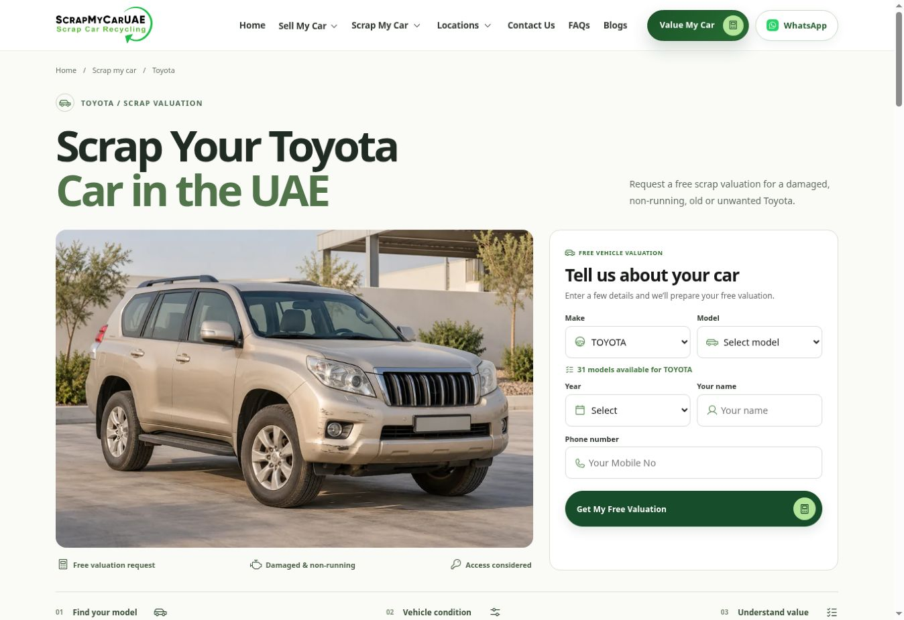

# Toyota manufacturer landing page QA

20 October 2026 · development / staging only.

Preview: https://smc-headless-worker.hussain-gscx.workers.dev/cars/toyota/

## Experience and architecture

An original manufacturer page family: editorial headline above a photographic valuation stage, live model explorer, charcoal condition workspace, numbered value disclosures, an asymmetric assessment dossier, three-stage process and searchable FAQs. Location components, coverage layouts and location photographs were not reused.

Shared integrations remain unchanged: BaseLayout SEO, QuoteForm validation/save/WhatsApp flow, and existing pill action buttons. Toyota data comes from `getVehicleData()`; the page filters the live CMS catalogue without adding hardcoded model options. At audit time there are 31 Toyota models. Only Toyota make/model data is passed to this page's shared form; the year options remain from the same live source.

New manufacturer UI components accept model profiles, available models and condition guidance. Display names, model guidance and condition content are separated from shared interaction logic. The page owns its editorial composition, photos and copy so future manufacturer pages can vary without cloning a location template. No other manufacturer page or global-navigation change was made.

## Responsive verification

Actual rendered measurements covered all five widths. Targeted phone and desktop sections were visually inspected; the final screenshot was captured in a separate browser after the local browser connection timed out.

| Width | Result | Main checks |
| --- | --- | --- |
| 390 | PASS | Two-line H1, short introduction, form before service points/photo; full-width make/model fields, compact year/name row; submit visible in an 844px-high viewport |
| 430 | PASS | Readable model/condition controls, selected states, complete vehicle compositions and no overflow |
| 768 | PASS | Form-first tablet hero; comfortable field widths; assessment photograph remains complete |
| 1024 | PASS | Editorial desktop hero; condition workspace fits; panels and touch controls readable |
| 1440 | PASS | Balanced photo/form stage, asymmetric assessment dossier, complete vehicles and consistent type rhythm |

All five samples: two-line H1, no document horizontal overflow, no detected clipped headings/copy/buttons, no audited button/select/input/CTA below 44px. Phone model fields were widened after visual review revealed truncated placeholder labels. Tablet hero was adjusted after the initial side-by-side form became narrow. The condition panel has a stable phone minimum height and changes through opacity only. These fixes are manufacturer-scoped; QuoteForm itself was not edited.

## Model explorer

- Six quick choices are filtered against the CMS list: Corolla, Camry, Yaris, Land Cruiser, Prado, Hilux. All six were selected in the browser; guidance and the shared form model updated correctly.
- The full model selector exposes the other currently available Toyota options. Hiace was selected and produced appropriate general guidance, then synchronized into the form.
- Reverse synchronization passed: changing the shared form model to CAMRY updates the explorer and full-model selector.
- Arrow keys, Home/End and Enter update selected state, roving focus and the panel label. Model valuation CTA moves to the quote form/year field; it does not submit or bypass year/name/phone validation.
- Initial page load prefills the existing Toyota make through the existing change event; it leaves the model and year for the customer to select.

## Condition selector

All six browser selections passed: accident damaged, engine problems, gearbox problems, non-running, flood damaged, old/unwanted. Each shows its distinct assessment guidance, three useful details, and the corresponding existing service link. Exactly one tab is selected. Home/arrow navigation and panel labeling passed. The already selected model remains unchanged throughout.

Condition selection provides guidance only. No condition fields, quote API schema, CMS fields or storage behavior were added. No automatic valuation, numerical price or acceptance guarantee is displayed.

## FAQ and form regression

- FAQ search for `documents`: one matching question; clear restores all eight. An unmatched search shows the empty result state. Search is local and performs no network call. Native FAQ summary Enter interaction passed.
- Shared form: one form, live make/model/year options, CAMRY + 2016 selection passed. Invalid phone `123` on blur produced `aria-invalid=true` and the existing UAE-mobile error message.
- No live enquiry was submitted. Existing automated tests continue to cover CMS-save-before-WhatsApp, collection isolation and field mappings. Shared QuoteForm/API/Wix/Brevo/Inbox/analytics files were not modified.
- Keyboard/focus rings, model/condition selector semantics and reduced-motion CSS/observer guards were reviewed. OS media preference was not emulated; no heavy animation library was added.

## SEO and assets

- One exact H1: `Scrap Your Toyota Car in the UAE`.
- Title: `Scrap Toyota Car in UAE | Free Valuation | Scrap My Car UAE`.
- Absolute canonical: `https://www.scrapmycaruae.com/cars/toyota/`.
- Staging meta `noindex,nofollow` and noindex response header remain in place. Production-host indexability and canonical policy pass isolated tests; production was not deployed.
- BreadcrumbList matches visible Home → Scrap my car → Toyota navigation. FAQPage is generated from the same eight visible questions/answers. No fake LocalBusiness or affiliation schema.
- Route is registered once in the existing static-route manifest. The actual production sitemap handler was exercised with isolated read-only Wix fixtures: Toyota appears exactly once; staging sitemap remains blocked.
- Two new photographs, each with 640/960/1440 variants. All six deployed files return HTTP 200, `image/webp`, and SHA-256 matches to local assets. Maximum file 140,172 bytes; phone versions 39,640 and 36,840 bytes. Hero is high priority; assessment is lazy loaded with dimensions and srcset/sizes. No decorative captions or location-photo reuse.
- Prompts and exact asset paths are in `docs/assets/toyota-images.md`; built-in image generation was used. Photos are representative editorial scenes and imply no Toyota endorsement.

## Final validation

- Automated tests: **159 passed / 0 failed / 0 skipped** (six focused Toyota/manufacturer tests added).
- Staging build: PASS.
- Production-mode build and production SEO guard: PASS locally; no production deployment.
- Staging SEO CLI: **44 PASS**.
- Internal service links target published routes; quote anchors target the single visible form. No new global menu links or nonexistent manufacturer parent links.

Remaining limits: no end-to-end CMS/WhatsApp enquiry submission, no OS-emulated reduced-motion run and no production deployment. Model availability remains controlled by live Wix data; missing data uses the existing form error/fallback rather than invented options. No fixed price or collection guarantee is offered.

Result: **PASS — Toyota staging page ready for review.**

